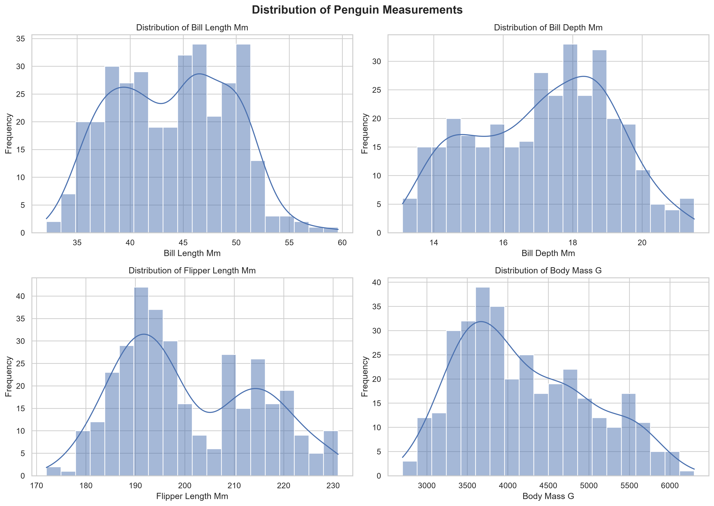
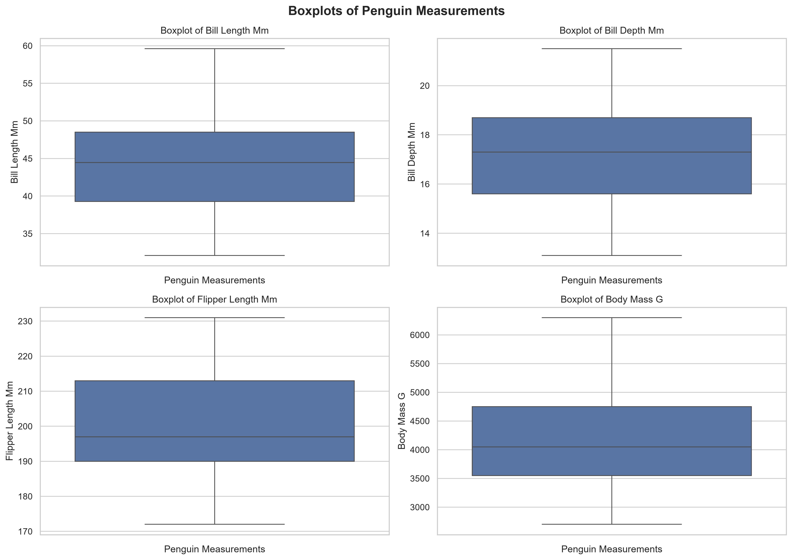
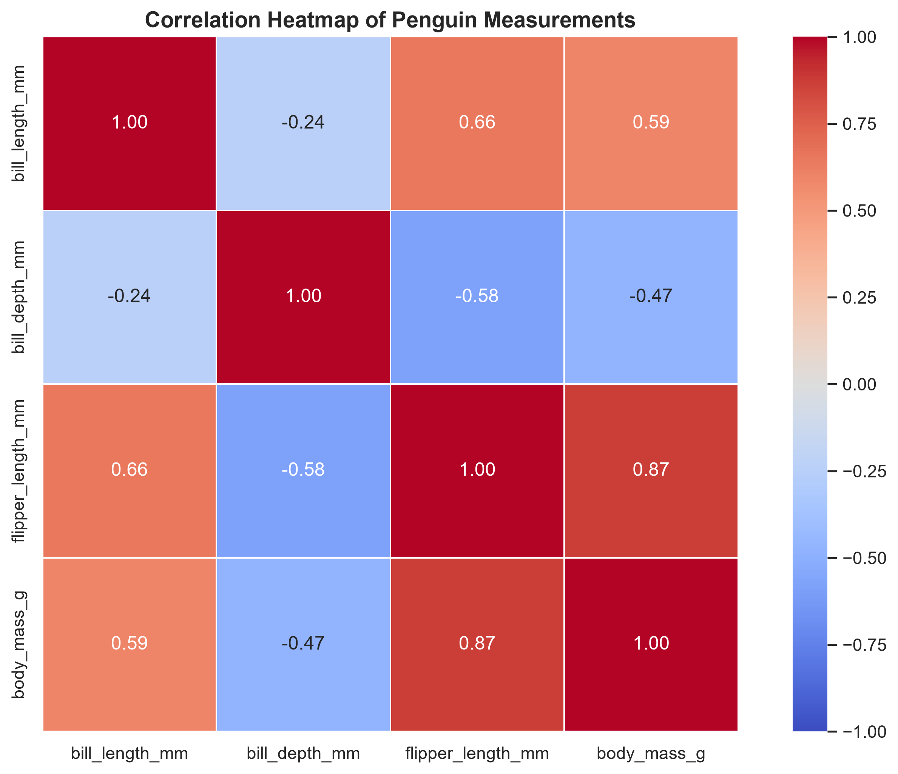
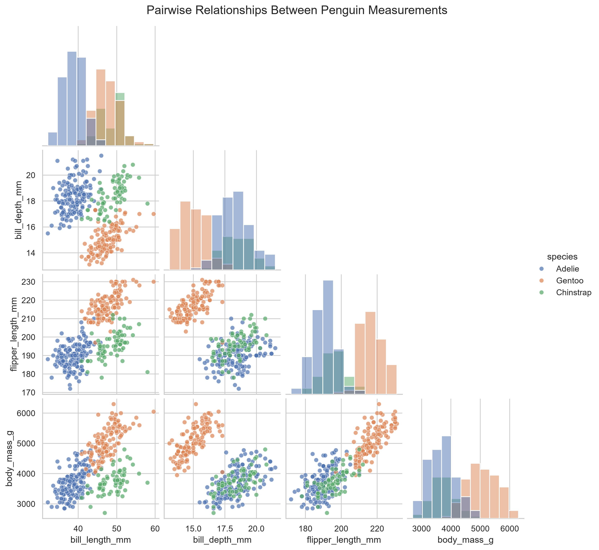

# Exploratory Data Analysis: Penguin Measurements

A Python-based Exploratory Data Analysis (EDA) project exploring penguin
measurements, data quality, feature distributions, and relationships
between numerical variables.

## Project Overview

This project uses a penguin dataset to demonstrate a structured EDA
workflow with **Python, Pandas, NumPy, Matplotlib, Seaborn, and Jupyter
Notebook**.

The analysis covers dataset inspection, missing-value assessment and
treatment, duplicate detection, IQR-based outlier analysis, statistical
visualizations, and correlation analysis.

## Objectives

-   Inspect the dataset's dimensions, columns, and data types.
-   Assess missing values and duplicate records.
-   Impute missing numerical measurements.
-   Identify potential outliers using the interquartile range (IQR)
    method.
-   Visualize numerical feature distributions.
-   Summarize numerical measurements with boxplots.
-   Examine linear relationships using a correlation heatmap.
-   Compare numerical measurements across penguin species.
-   Document observations supported by the notebook's outputs.

## Dataset

The dataset contains **344 records and 8 columns**.

  Column                Description
  --------------------- ---------------------------------------
  `species`             Penguin species
  `island`              Island where the penguin was recorded
  `bill_length_mm`      Bill length in millimeters
  `bill_depth_mm`       Bill depth in millimeters
  `flipper_length_mm`   Flipper length in millimeters
  `body_mass_g`         Body mass in grams
  `sex`                 Recorded sex category
  `year`                Year of observation

The three species represented are **Adelie, Chinstrap, and Gentoo**.

The dataset file is stored at `data/penguins.csv`.

## Tools and Technologies

-   Python
-   Pandas
-   NumPy
-   Matplotlib
-   Seaborn
-   Jupyter Notebook

## Analysis and Data Cleaning

### 1. Dataset Inspection

The notebook inspects the dataset's dimensions, column names, data
types, and summary statistics before analysis.

### 2. Missing Values

The initial missing-value analysis identified:

  Column                  Missing values
  --------------------- ----------------
  `bill_length_mm`                     2
  `bill_depth_mm`                      2
  `flipper_length_mm`                  2
  `body_mass_g`                        2
  `sex`                               11

The four numerical measurement columns were imputed using their
respective column medians. The median is less sensitive to extreme
values than the mean.

**Important:** The 11 missing values in `sex` remained after numerical
imputation. They are categorical missing values and require a separate
decision---for example, retaining them as missing or assigning an
explicit `Unknown` category if appropriate for a later analysis.

### 3. Duplicate Records

The initial duplicate check found **0 duplicate rows**. Therefore, no
rows were removed as duplicates.

### 4. Outlier Detection

The IQR method was applied to the four numerical measurement columns. In
the notebook's reported results, the outlier count was **0 for each of
the four columns**.

No observations were removed based on this test. Outlier detection
depends on the chosen method and preprocessing steps, so this result
should be interpreted as a finding of the implemented IQR analysis---not
proof that the dataset contains no unusual observations.

## Visualizations

### 1. Feature Distributions

Histograms showing the distributions of bill length,
bill depth, flipper length, and body mass.



### 2. Measurement Boxplots

Boxplots illustrating the medians, interquartile ranges,
and spread of the numerical measurements.



### 3. Correlation Heatmap

A heatmap showing the Pearson correlation coefficients
between the four numerical measurement features.



### 4. Pairwise Scatter Plots

Pairwise plots showing relationships between numerical
measurements, with observations grouped by penguin species.



## Key Findings

### Correlation Analysis

The notebook reports the following Pearson correlation coefficients:

  Feature pair                       Correlation
  -------------------------------- -------------
  Flipper length and body mass              0.87
  Bill length and flipper length            0.66
  Bill length and body mass                 0.59
  Bill depth and flipper length            -0.58
  Bill depth and body mass                 -0.47
  Bill length and bill depth               -0.24

-   **Flipper length and body mass** have the strongest positive linear
    association among the pairs listed (`r = 0.87`).
-   Bill length also has positive associations with flipper length and
    body mass.
-   Bill depth has negative associations with flipper length and body
    mass in the combined dataset.
-   The pairwise plots suggest that species-level differences are
    important when interpreting these relationships.

These correlations describe associations, not cause-and-effect
relationships. The overall correlations may partly reflect differences
between species; a separate within-species analysis would be needed to
investigate that further.

## Project Structure

``` text
EDA_Statistical_Visualization/
├── data/
│   └── penguins.csv
├── notebooks/
│   └── EDA_Analysis.ipynb
├── visualizations/
│   ├── correlation_heatmap.png
│   ├── feature_distributions.png
│   ├── measurement_boxplots.png
│   └── pairwise_scatterplots.png
├── README.md
└── .gitignore
```

The `.venv/` directory may also exist locally. It should generally be
excluded from version control rather than uploaded to GitHub.

## How to Run

### 1. Open the project

Open the `EDA_Statistical_Visualization` folder in VS Code.

### 2. Create and activate a virtual environment (optional)

If you already have a working project environment, you can continue
using it.

**Windows PowerShell:**

``` powershell
python -m venv .venv
.\.venv\Scripts\Activate.ps1
```

### 3. Install the required libraries

``` bash
python -m pip install pandas numpy matplotlib seaborn jupyter ipykernel
```

### 4. Open and run the notebook

1.  Open `notebooks/EDA_Analysis.ipynb`.
2.  Select the project's Python environment as the notebook kernel.
3.  Run the cells in order.
4.  Confirm that the visualizations are generated and saved in
    `visualizations/`.

## Conclusion

This project demonstrates a practical EDA workflow, including data
profiling, missing-value assessment, numerical imputation, duplicate
detection, IQR-based outlier analysis, and statistical visualization.

The analysis highlights a strong positive association between flipper
length and body mass and shows why species-level comparisons are useful
when exploring penguin measurements. The 11 missing `sex` values remain
a separate categorical-data consideration.

All conclusions are descriptive and should be interpreted in the context
of the dataset, preprocessing choices, and visualizations produced by
the notebook.